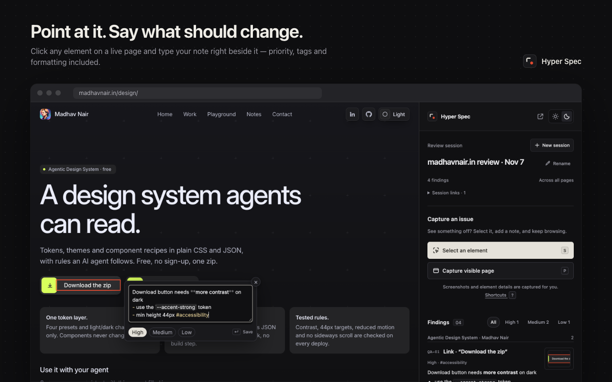
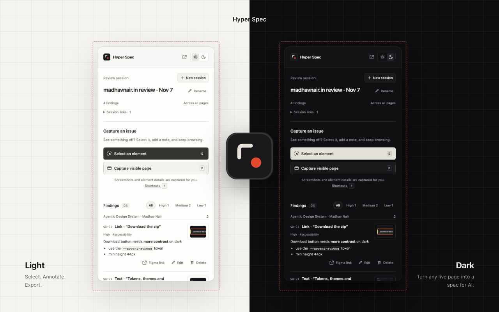

<div align="center">
  
  <h1>Hyper Spec</h1>
  <p><strong>Turn any live page into a spec your AI can build from.</strong></p>
  <p>Select an element. Describe the change. Export the context.</p>
  <p>
    <a href="#install">Install</a> ·
    <a href="#how-it-works">How it works</a> ·
    <a href="CHANGELOG.md">What's new</a> ·
    <a href="https://mad7droid.github.io/hyper-spec/privacy/">Privacy</a> ·
    <a href="SECURITY.md">Security</a>
  </p>
</div>



Hyper Spec is a Chrome and Brave extension for **designers, product managers, and front-end developers**. Mark the exact UI you want changed and hand Claude Code, Codex, or a teammate a report with your notes, selectors, computed styles, and marked screenshots.

No account, API key, server, or build step is needed to use the extension.

## Install

**[Chrome Web Store →](https://chromewebstore.google.com/detail/oolffllmbjflkicfkfiagiabmjbojilp)**

The store's published version may lag this repository. Version 1.1.0 was submitted for review on November 7, 2026; the security changes in 1.1.1 are available here and have not been submitted to the store.

### Load from source

Requires Chrome 116+ or a Chromium browser with side-panel support, such as Brave. Firefox and Safari are not supported.

1. Clone this repository or download and unzip its source.
2. Open `chrome://extensions` or `brave://extensions`.
3. Enable **Developer mode** and choose **Load unpacked**.
4. Select the **`extension/`** folder.
5. Pin **Hyper Spec**, open a website, and click its toolbar icon.

After pulling changes, reload the extension on the extensions page and refresh existing website tabs.

## How it works

1. **Select.** Press **S** or choose **Select an element**. Hover to see the element's name and size; use **↑ / ↓** to move to its parent or child, then click or press **Enter**. Use **P** for a viewport capture.
2. **Annotate.** Start typing in the note box beside the selected element. Add formatting, `#tags`, priority, and reference links. **Enter** saves; **Shift+Enter** adds a line. **⌘/Ctrl+Enter** saves and selects the next element.
3. **Review.** Continue across pages and tabs. Findings are grouped by page, with thumbnails and a priority filter. Edit in the side panel or pop it out into a floating window.
4. **Export.** Copy Markdown for a quick handoff, or download a ZIP with screenshot evidence. Review the files before sharing them with an AI tool or teammate.

The first finding names your session automatically. Add session-wide Figma/spec links or attach links to individual findings. Delete, discard, and new-session actions support Undo; one previous review is retained for recovery.

### Built for detailed feedback

| Feature | What you get |
| --- | --- |
| Precise selection | Element labels, dimensions, and parent/child navigation |
| Notes on the page | Focused input, Markdown formatting, priority, and hashtags |
| Captured context | CSS selector, computed styles, viewport details, and component hints |
| Visual evidence | Marked viewport screenshots and close-ups of selected elements |
| Organized reviews | Findings grouped by page, thumbnails, tags, and reference links |
| Flexible workspace | Side panel or floating window, with light and dark themes |

<details>
<summary><strong>See the light and dark interface</strong></summary>



</details>

## Hand a report to your coding agent

Choose **Copy Markdown** to paste the report as text. Copied reports do not contain screenshots; use **Export report** when you need visual evidence.

```text
review.zip
├── report.md                       # Notes, priorities, selectors, styles, links
├── session.json                    # Structured findings, schema version 1
└── screenshots/
    ├── <finding-id>.png             # Marked visible viewport
    └── <finding-id>-closeup.png     # Close-up when an element was selected
```

Unzip the report, attach `report.md` and the relevant screenshots to your agent, and describe the scope of the work. For example:

> Review the findings in report.md and fix the spacing issues. Use the selectors and screenshots as evidence, inspect the source, and verify the result.

Page text, links, and notes are untrusted report data. Review them before asking an agent to act on the report. Component names are hints, not guaranteed mappings to source files.

## Keyboard shortcuts

Use **⌘** on macOS and **Ctrl** on Windows/Linux. Single-key shortcuts work outside text fields; page-level **S/P** require an open review panel.

| Action | Shortcut | Where |
| --- | --- | --- |
| Select an element / capture viewport | `S` / `P` | Panel or page |
| Parent / child element | `↑` / `↓` | Picker |
| Select highlighted element | `Enter` | Picker |
| Save / add a line | `Enter` / `Shift+Enter` | On-page note¹ |
| Save and select next | `⌘/Ctrl+Enter` | On-page note |
| High / Medium / Low priority | `Alt+1` / `Alt+2` / `Alt+3` | On-page note |
| Save finding | `⌘/Ctrl+Enter` | Panel editor |
| Toggle tag 1–8 | `Alt+1`–`Alt+8` | Panel editor |
| Discard capture / cancel selection | `Esc` | Editor or picker |
| Undo delete, discard, or new session | `⌘/Ctrl+Z` | Panel, outside fields |
| Export / copy Markdown | `E` / `⌘/Ctrl+Shift+C` | Panel |
| Focus note / show shortcuts | `C` / `?` | Panel |

¹ Enter continues Markdown lists. A very short note shows a hint before saving on a second Enter. On macOS, **Alt** is **⌥ Option**.

Global defaults: `Alt+Shift+Q` opens Hyper Spec, `Alt+Shift+S` selects an element, and `Alt+Shift+P` captures the viewport. Change these at `chrome://extensions/shortcuts` or `brave://extensions/shortcuts` if your browser or OS reserves them.

## Privacy and permissions

Reviews and screenshots stay in extension storage on your device. Hyper Spec has no analytics, ads, remote scripts, automatic AI calls, or review-data sync. Exporting creates local files; sharing those files is your choice.

| Permission | Purpose |
| --- | --- |
| Website access (`<all_urls>`) | Capture and inspect sites you review across navigations |
| `scripting` | Inject the packaged picker and read selected-element specifications |
| `sidePanel` | Show the review interface beside the page |
| `storage` / `unlimitedStorage` | Retain reviews, drafts, and PNG evidence locally |

A small packaged listener enables S/P on pages while the panel is open. It does not read page content. The picker reads page content when you select an element. Review storage is restricted to trusted extension contexts; the on-page note editor can update only its matching capture.

**Screenshots can include sensitive content visible on the page.** Inspect exports before sharing them. One current and one previous review are retained; exported copies must be deleted separately. See the [privacy policy](https://mad7droid.github.io/hyper-spec/privacy/) and [security policy](SECURITY.md).

## Limitations

- Captures cover the visible viewport, not a stitched full page. Partly visible elements remain partly shown.
- Selection supports the top document and open shadow DOM. Cross-origin frames, closed shadow DOM, canvas internals, and browser-protected pages cannot be inspected individually.
- Styles represent the captured state. Framework names may be absent or minified in production.
- Local storage is not a backup or an encrypted vault. The extension keeps one current and one previous review, without device sync.

## Development

Plain HTML, CSS, and JavaScript using Manifest V3. Node.js 20+ is required for the development tools. There are no third-party runtime dependencies.

```sh
npm ci
npx playwright install chromium
npm test
npm run check
npm run test:browser
npm run test:extension
```

The browser suite exercises the panel with mocked Chrome APIs and the real picker against fixture pages. It defaults to installed Chrome on macOS; set `CHROME_PATH` elsewhere. The real-extension suite loads the unpacked extension in Playwright Chromium and tests capture, inline notes, shortcuts, and storage isolation. Set `CHROMIUM_PATH` to override its executable.

```sh
npm run package       # Runtime-only ZIP and SHA256 checksum under .context/release/
npm run store:assets  # Listing images; requires Chrome and access to madhavnair.in
```

| Location | Contents |
| --- | --- |
| [`extension/`](extension/) | Installable extension and bundled privacy policy |
| [`tests/`](tests/) | Report, UI, security, and real-extension tests |
| [`docs/store/`](docs/store/) | Listing screenshots and promotional assets |
| [`docs/privacy/`](docs/privacy/) | Public policy served by GitHub Pages |
| [`release/`](release/) | Listing copy, disclosures, reviewer notes, and submission status |

Read [What's new](CHANGELOG.md), [design notes](DESIGN.md), and [release instructions](release/PUBLISH.md) for more context. Report bugs through [GitHub Issues](https://github.com/Mad7droid/hyper-spec/issues); report vulnerabilities privately as described in [SECURITY.md](SECURITY.md).

---

Made by [Madhav Nair](https://madhavnair.in). Listing screenshots use dark subpages of madhavnair.in with example review notes. Hyper Spec is independent of Anthropic, OpenAI, Figma, Linear, and Google.
