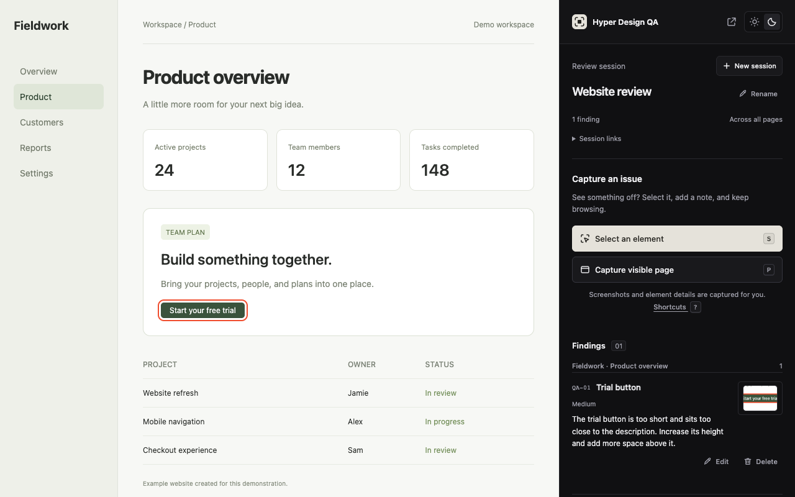
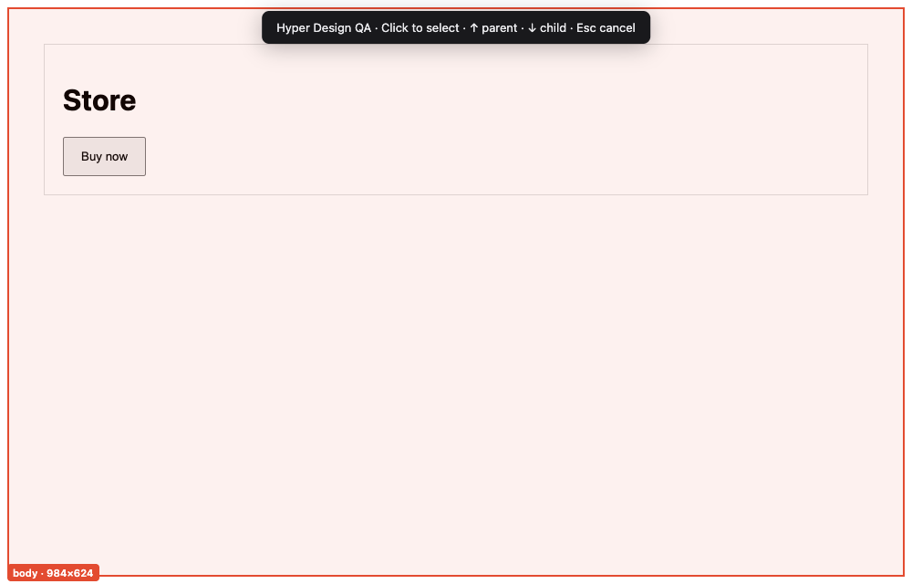
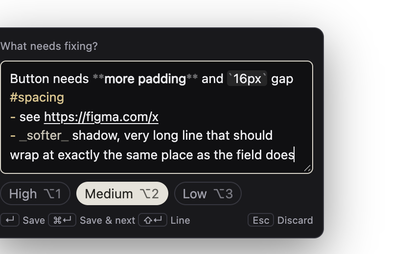
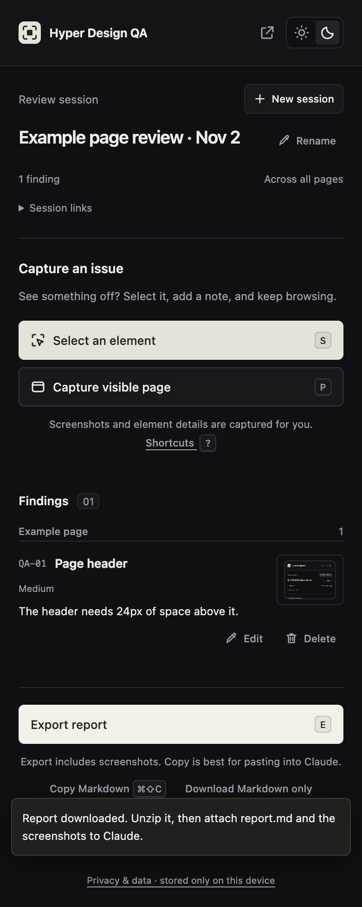
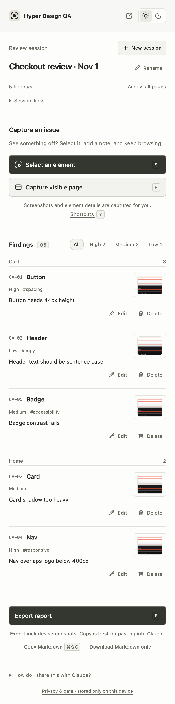
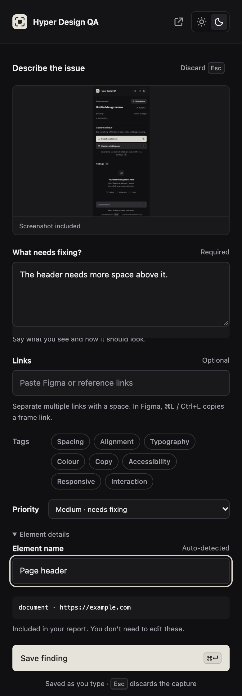
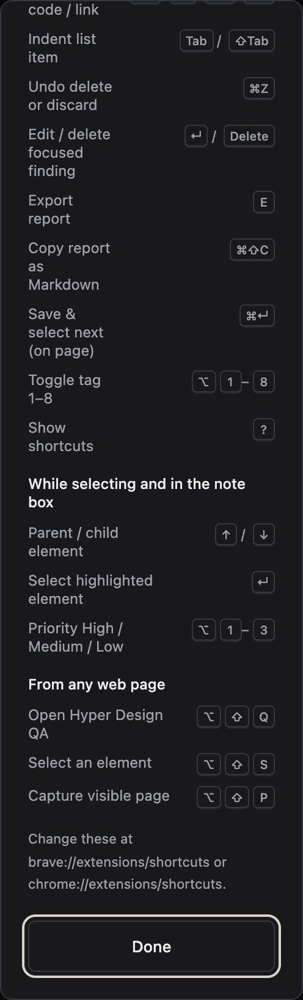

# Hyper Design QA

**Point at what's wrong, say why, export a report Claude can act on.**

Hyper Design QA is a Chrome/Brave extension for design QA. Select any element on a live site, type a note right next to it, and collect findings across pages in one session. Export clean Markdown + marked screenshots + JSON that people and AI can both read.

[What's new](CHANGELOG.md) · [Privacy policy](https://hyper-design-qa-privacy.mad7droid.chatgpt.site/privacy/) · [Design notes](DESIGN.md)



## Highlights

- **Select and type.** Click an element and a note box opens beside it, cursor ready. `↵` saves, `Esc` or `×` discards, `⌥1`–`⌥3` sets priority.
- **Precise selection.** A label shows the element's name and size; `↑`/`↓` moves to the parent or child.
- **Readable names.** `Button · “Reply”` instead of `div`, or the React/Vue component name when the site exposes one.
- **Rich notes, styled as you type:** lists, bold, italic, code, and links (`⌘B` `⌘I` `⌘E` `⌘K`).
- **Specs captured for you:** selector, size, typography, colour, spacing, a marked screenshot, and a close-up.
- **Links and tags.** Attach Figma or design links per finding or per session; tag with chips, `⌥1`–`⌥8`, or `#hashtags`.
- **Findings grouped by page** with thumbnails, a priority filter, and **Figma link** / **Design link** buttons.
- **Keyboard first.** `S` select, `P` capture page, `⌘↵` save, `⌘Z` undo, `E` export, `?` all shortcuts.
- **Export for people and AI:** a ZIP with `report.md`, `session.json`, and screenshots, named after the site and time; or **Copy Markdown** (`⌘⇧C`).
- **Works across pages and tabs**, in a side panel or floating window, light or dark. Everything stays on your device.

<p>
  
  
</p>
<p>
  
  
  
</p>

## Install locally

Works in Google Chrome 116+ and Chromium browsers with side-panel support, such as Brave. A Chrome Web Store version is in review; until then, install it locally:

1. Open `chrome://extensions` (or `brave://extensions`).
2. Turn on **Developer mode**, then choose **Load unpacked**.
3. Select this repository’s **extension** folder.
4. Pin **Hyper Design QA** from the extensions menu. Open a website and click the extension (or press `⌥⇧Q` / `Alt+Shift+Q`) to open its side panel.

No build, account, API key, or server is required. After pulling updates, click the reload icon on the extension card. It targets Chrome’s side panel API; Firefox and Safari are not supported.

## Review a website

1. Start reviewing. The session is named after the site automatically (rename it any time). Optionally add **Session links** (Figma file, spec, ticket).
2. Press **S** or click **Select an element**, then click the element on the page. **↑/↓** picks the parent or child; **Esc** cancels. **P** captures the visible page instead.
3. Type your note in the box that appears beside the element. **↵** saves it, **⇧↵** adds a line, **⌥1–3** sets priority, **Esc** or **×** discards it. Click away to keep the draft and finish it in the panel.
4. In the panel you can add **Links**, rename the element, and set a priority. **⌘↵** / **Ctrl+↵** saves.
5. Navigate to other pages or tabs and repeat. Use the pop-out icon for a floating window; **Return to side panel** docks it again.
6. Press **E** or click **Export report**. Unzip it and attach `report.md` and the screenshots to Claude. **Download Markdown only** exports text without images.

Edit or delete findings from their cards. Delete, discard, and new session can all be undone with **⌘Z** / **Ctrl+Z** or the Undo button. **Restore previous review** switches between the current and previous session.



## Keyboard shortcuts

| In the panel | |
|---|---|
| Select an element | `S` |
| Capture visible page | `P` |
| Save finding | `⌘↵` / `Ctrl+↵` |
| Discard capture | `Esc` or `Delete` |
| Jump to note | `C` |
| Undo delete, discard, or new session | `⌘Z` / `Ctrl+Z` |
| Edit / delete a focused finding | `↵` / `Delete` |
| Export report | `E` |
| Copy report as Markdown | `⌘⇧C` / `Ctrl+Shift+C` |
| Toggle tag 1–8 | `⌥1`–`⌥8` / `Alt+1`–`Alt+8` |
| Save & select next (on-page box) | `⌘↵` / `Ctrl+↵` |
| Show all shortcuts | `?` |

| While selecting / in the note box | |
|---|---|
| Parent / child element | `↑` / `↓` |
| Select highlighted element | `↵` |
| Priority High / Medium / Low | `⌥1`–`⌥3` / `Alt+1`–`Alt+3` |

| From any web page | |
|---|---|
| Open Hyper Design QA | `⌥⇧Q` / `Alt+Shift+Q` |
| Select an element | `⌥⇧S` / `Alt+Shift+S` |
| Capture visible page | `⌥⇧P` / `Alt+Shift+P` |

Single-key shortcuts don't fire while you're typing. Change the global ones at `chrome://extensions/shortcuts` or `brave://extensions/shortcuts`.

## Report contents

- `report.md`: consistent headings, session reference links, finding IDs, priority, comments, per-finding links, page URL and title, component label and its source, selector, marked screenshot link, and JSON specifications.
- `session.json`: schema version 1 with structured findings and relative screenshot paths.
- `screenshots/<finding-id>.png`: visible-page evidence with the selected element outlined.

Captured specs include dimensions, viewport size, scroll position, pixel ratio, typography, spacing, colors, borders, layout, opacity, and shadows. React/Vue names are read from exposed runtime metadata when possible. Otherwise `data-component`, `data-testid`, or the HTML tag provides a label. These are hints, not guaranteed source-file mappings. You can rename a finding without losing its selector.

## Current boundaries

- Screenshots capture the **visible viewport**, not a stitched full page. A partly visible element is only partly shown.
- Selection works in the top document and open shadow DOM. Cross-origin frames, closed shadow DOM, canvas internals, and browser-protected pages cannot be inspected individually.
- Computed styles describe the captured state, not every responsive, hover, or interaction state. Framework names may be absent or minified in production.
- This version maintains one current session and one previous review for recovery. It does not send reports automatically to Claude or sync between devices.
- Screenshots can contain private page content. Review the exported files before sharing them.

## Permissions and data

Website access is needed to activate the picker on sites you navigate to and capture their visible viewport. Capture scripts only run when you start a capture. A tiny packaged listener (`hotkeys.js`) lets **S** and **P** work from the page while the panel is open; it reads no page content and does nothing when the panel is closed. `scripting` reads the selected element, `sidePanel` hosts the review UI, and `storage` / `unlimitedStorage` preserve findings and PNG evidence locally. The extension uses `<all_urls>` for cross-page capture; it does not also request the redundant `activeTab` permission. There are no analytics, external requests, or remote scripts in the extension. One current and one previous review are kept in extension storage. Starting another new session replaces the older saved review.

## Development and checks

The extension is plain HTML, CSS, and JavaScript using Manifest V3. After editing, reload it in `chrome://extensions` and reopen the side panel.

```sh
npm install
npm test
npm run check
npm run test:browser
```

The browser suite uses an installed Chrome executable on macOS. Set `CHROME_PATH` on other systems. It tests the rendered panel with mocked Chrome APIs and tests the real element picker against a fixture. It covers capture, required comments, saving, links, reload persistence, editing, delete/undo, keyboard shortcuts, the inline note box, ZIP downloads, narrow layouts, selection metadata, and Escape cancellation. The report tests cover Markdown formatting and ZIP structure. Browser permission prompts, side-panel integration, and real `captureVisibleTab` still require a manual loaded-extension smoke test.

## UX references

The interface uses near-black surfaces, fine dividers, compact typography, and a warm ivory primary action in the requested Linear dark-mode direction. Research and implementation decisions are recorded in [DESIGN.md](DESIGN.md).

## Chrome Web Store release

Run `npm run package` to build the upload ZIP under `.context/release/`. Listing copy, privacy disclosures, and reviewer instructions live in `release/`. The package includes only runtime extension files. Store assets and release status are prepared separately. Public availability requires submission and approval through the Chrome Web Store developer dashboard.

The public privacy-page source is in `privacy-site/`. README screenshots in `docs/screenshots/` are generated by `npm run test:browser` (saved to `.context/`).
